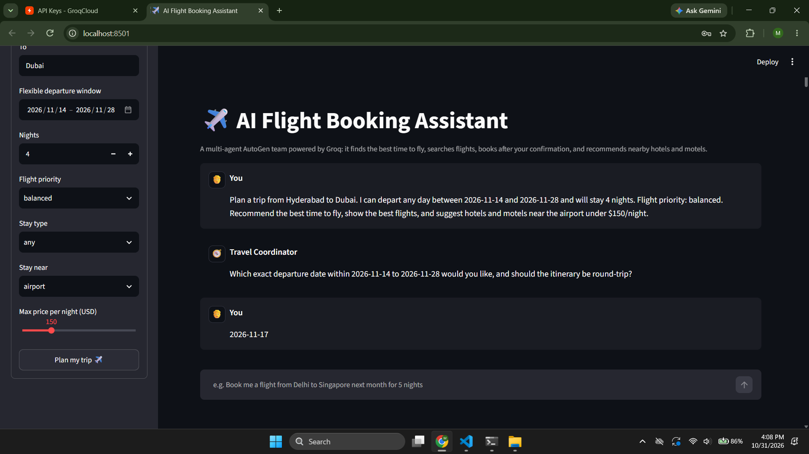
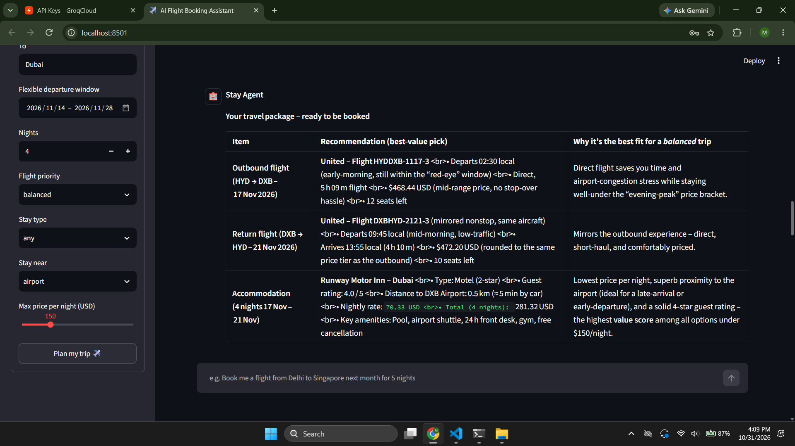

# AI Flight Booking Assistant

A Python travel-planning demo with a multi-agent team. It compares travel dates,
searches flights, recommends nearby hotels or motels, and only attempts a flight
booking after the traveller confirms. A Streamlit UI and a terminal interface
share the same agent team and travel tools.

> **Demo only:** flight, hotel, fare, and booking data are generated locally.
> This project does not connect to airlines, hotel providers, or payment systems,
> and it does not make real reservations.

## Technology stack

| Technology | How it is used |
|---|---|
| Python | Application and travel-tool implementation |
| [Microsoft AutoGen](https://github.com/microsoft/autogen) | Defines the specialist agents, tool calls, and multi-agent conversation |
| [Groq API](https://console.groq.com/) | Language-model inference through Groq's OpenAI-compatible API |
| [AutoGen OpenAI model client](https://microsoft.github.io/autogen/stable/user-guide/agentchat-user-guide/tutorial/models.html) | Connects AutoGen to the Groq-compatible chat-completions endpoint |
| [Streamlit](https://streamlit.io/) | Browser-based chat UI and trip-preference form |
| [NeMo Guardrails](https://github.com/NVIDIA/NeMo-Guardrails) | Applies the configured output privacy flow before assistant text is shown |
| [python-dotenv](https://pypi.org/project/python-dotenv/) | Loads local environment settings from `.env` |

**LangChain is not currently used** by this project. The tool functions are
registered directly with AutoGen; LangChain is not a dependency in
`requirements.txt`.

## Agents and tools

| Agent | Role | Tools |
|---|---|---|
| Travel Coordinator | Gathers requirements, delegates, writes the final itinerary | – |
| Timing Advisor | Best day and time of day to fly across a flexible date window | `recommend_best_travel_time` |
| Flight Agent | Searches flights, books after explicit confirmation | `search_flights`, `book_flight` |
| Stay Agent | Hotels and motels near the airport or city centre, ranked by value | `search_nearby_stays` |

The agents run as a `SelectorGroupChat` with deterministic turn order, avoiding extra LLM
requests just to select the next agent.

The tools in `travel_tools.py` generate deterministic mock data. Replace their
implementations with a real provider integration before using real availability
or prices.

## Architecture

```text
Streamlit UI (app.py) or console UI (main.py)
                    |
           AutoGen SelectorGroupChat
                    |
   Coordinator + timing / flight / stay agents
                    |
       Local mock tools in travel_tools.py
                    |
          Groq chat-completions API
```

The console and web UI use the same team definition in `agents.py`. The
deterministic speaker selector avoids spending an additional model request just
to select the next agent. Agent requests and responses still use Groq inference.

## Project structure

```
flight_booking_agent/
├── app.py            # Streamlit web UI
├── main.py           # Console (terminal) version
├── agents.py         # AutoGen team definition (shared by both UIs)
├── travel_tools.py   # Flight / timing / hotel / booking tools (mock data)
├── privacy_guardrails.py # NeMo Guardrails privacy filtering
├── guardrails/privacy/ # Output PII masking configuration
├── test_tools.py     # Offline tool tests (no API key needed)
├── test_privacy_guardrails.py # Offline privacy-policy tests
├── requirements.txt
├── run_app.bat       # Windows: double-click to install + launch the UI
├── .env.example
├── output-pics/      # Sanitized screenshots
└── README.md
```

## Screenshots

The images below show the trip-planning form and a sample itinerary. Screenshots
containing conversation details are redacted in the public copies.





## Setup

Requires Python 3.10+.

**Windows (PowerShell):**

```powershell
py -3 -m venv .venv
.\.venv\Scripts\python.exe -m pip install -r requirements.txt
```

**macOS / Linux:**

```bash
python3 -m venv .venv
./.venv/bin/python -m pip install -r requirements.txt
```

Using a virtual environment ensures pip installs packages for the same Python
interpreter that runs the application.

Create a Groq API key in [Groq Console](https://console.groq.com/keys).
Copy `.env.example` to `.env` and add your key, or paste it into the app's sidebar:

```powershell
# PowerShell
Copy-Item .env.example .env
$env:GROQ_API_KEY="your-groq-api-key"
```
```bash
# macOS / Linux
cp .env.example .env
export GROQ_API_KEY="your-groq-api-key"
```

## Run

**Web UI (Streamlit)**

**Windows**

```powershell
.\.venv\Scripts\python.exe -m streamlit run app.py
```

**macOS / Linux**

```bash
./.venv/bin/python -m streamlit run app.py
```
On Windows you can also double-click `run_app.bat`. The app opens at http://localhost:8501.

**Console**

**Windows**

```powershell
.\.venv\Scripts\python.exe main.py
```

**macOS / Linux**

```bash
./.venv/bin/python main.py
```

**Tests (no API key needed)**

**Windows**

```powershell
.\.venv\Scripts\python.exe test_tools.py
.\.venv\Scripts\python.exe test_privacy_guardrails.py
```

**macOS / Linux**

```bash
./.venv/bin/python test_tools.py
./.venv/bin/python test_privacy_guardrails.py
```

## Configuration

| Variable | Default | Purpose |
|---|---|---|
| `GROQ_API_KEY` | – | Your Groq API key from Groq Console |
| `GROQ_MODEL` | `openai/gpt-oss-120b` | Groq model used by the agents |

AutoGen connects to Groq through its OpenAI-compatible API endpoint.

## Privacy safeguards

The web app blocks requests to identify a guest from a reservation code and uses
a NeMo Guardrails output rail with local pattern-based redaction for common PII
(including contextual guest names, email addresses, phone numbers, card numbers,
SSNs, and IBANs). Reservation codes are withheld from generated output, and
booking summaries do not include passenger names or email addresses. Name
redaction depends on surrounding labels such as “guest” or “passenger”; it is
not general-purpose person-name recognition.

These safeguards are not user authentication or access control. The app does not
verify booking ownership, and booking requests still send the details needed to
Groq for the agent workflow. Do not use this mock-data app to process real bookings
or sensitive passenger information without adding authenticated, per-user storage
and a provider-approved privacy design.

## Troubleshooting

- **Groq HTTP 429:** Check your Groq account's model limits and usage, then retry
  after the relevant limit window resets. Multi-agent tasks can use several
  model requests.
- **Groq HTTP 404:** Confirm `GROQ_MODEL` names a model currently available to
  your Groq account.
- **API key encoding error:** Set `GROQ_API_KEY` to the plain ASCII key from
  Groq Console; do not include quotes, emojis, or copied formatting.
- **Missing API key:** Add it to `.env` or paste it into the Streamlit sidebar.
  Never commit `.env` or real credentials.

## Using real travel data

`travel_tools.py` generates realistic **mock** flights, fares, hotels and booking references so the
project runs without paid travel APIs. To go live, replace the body of each function with calls to a
real provider (e.g. Amadeus, Duffel or Skyscanner for flights; Amadeus Hotel Search, Booking.com or
Google Places for stays). Keep the same function signatures and return shapes, and the agents keep
working unchanged. Bookings are currently stored in memory only.
